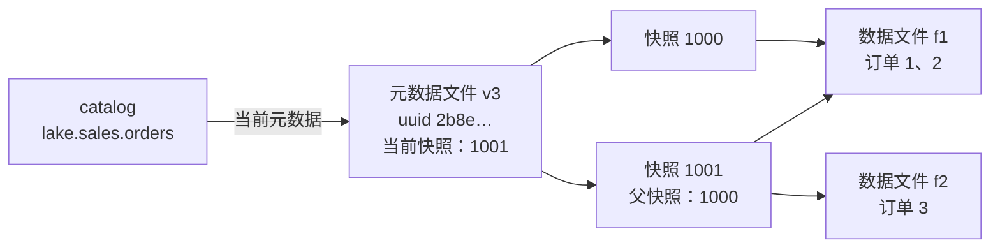
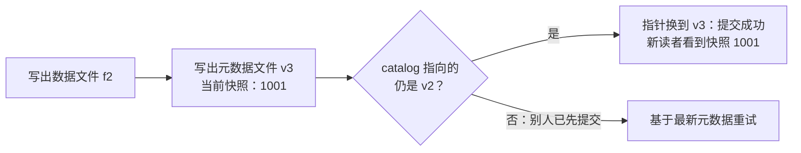
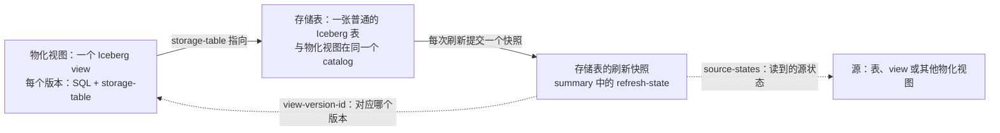
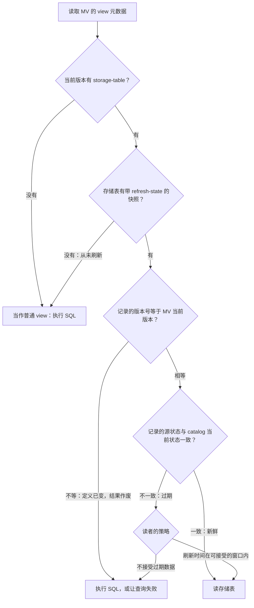
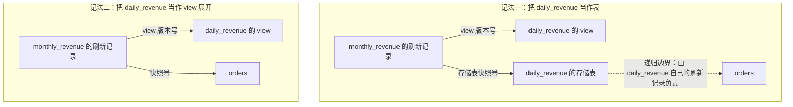

<!--
Licensed to the Apache Software Foundation (ASF) under one
or more contributor license agreements.  See the NOTICE file
distributed with this work for additional information
regarding copyright ownership.  The ASF licenses this file
to you under the Apache License, Version 2.0 (the
"License"); you may not use this file except in compliance
with the License.  You may obtain a copy of the License at

  http://www.apache.org/licenses/LICENSE-2.0

Unless required by applicable law or agreed to in writing,
software distributed under the License is distributed on an
"AS IS" BASIS, WITHOUT WARRANTIES OR CONDITIONS OF ANY
KIND, either express or implied.  See the License for the
specific language governing permissions and limitations
under the License.
-->

# 把物化视图写进 Iceberg 规范：一个指针，一份刷新记录

前两篇文章（[用 Iceberg v3 实现增量物化视图的原理](incremental-materialized-views-on-iceberg-v3/incremental-materialized-views-on-iceberg-v3.md)、[一条查询把增量刷新算清楚](applying-incremental-changes-to-iceberg-materialized-views.md)）讲了怎样把物化视图（Materialized View，MV）增量地维护成一张标准的 Iceberg 表。结果存成开放的表格式，别的引擎不需要原引擎在场，也能读到它。

但"能读到"只解决了一半。Spark 或 Trino 打开这张表，看到的只是一张普通表。它不知道这张表是**哪个查询的结果**，不知道结果对应的是**定义的哪个版本**，也不知道和底表相比，它**是不是已经过期**。这些信息原本只存在于产生它的那个引擎的私有元数据里。别的引擎即使读到了数据，也不敢拿它去回答"那个查询"。

Iceberg 社区正在把这块空白补进规范，这就是物化视图规范（Materialized View Spec）。它目前还以 [apache/iceberg#11041](https://github.com/apache/iceberg/pull/11041) 的形式在社区评审中。规范要回答三个问题：

1. 一个物化视图由什么组成？
2. 一份预计算结果是基于什么算出来的，怎么记下来？
3. 读者怎么判断这份结果现在能不能用？

它的答案可以浓缩成标题里的两样东西：**一个指针，一份刷新记录**。下面先补齐需要的 Iceberg 基础知识，再概括规范到底定义了什么，然后逐一讲这些定义背后的道理。

---

## 一、先补背景：Iceberg 的表、快照和 view

物化视图规范建立在 Iceberg 已有的几样东西之上。没接触过 Iceberg 也没关系，这一节用一张订单表和一个 view，把后文要用到的概念从头走一遍。

### 1. 一张表 = 一堆数据文件 + 描述它们的元数据

先看 Iceberg 要解决的问题。湖仓里的数据通常以 Parquet 等格式的文件，存放在对象存储（object storage，比如 S3）上。对象存储只认识"文件"：它不知道哪些文件合起来是一张表，也不知道一次写入有没有写完。如果每个引擎都靠列目录来猜表里有哪些文件，一个引擎写到一半，另一个引擎就可能读到半成品。

Iceberg 是一种表格式（table format）。它不改变数据文件本身，而是额外维护一份**元数据**，明确记下"这张表现在由哪些文件组成"。整个结构分三层：

- **catalog**：表的目录。它把表名映射到这张表**当前**的元数据文件位置。表名形如 `lake.sales.orders`：`lake` 是 catalog 的名字，`sales` 是 namespace（相当于数据库），`orders` 是表名。
- **元数据文件**（metadata file）：一个 JSON 文件，记录表的 schema、表的身份标识 uuid、所有快照（下一小节解释），以及哪个快照是"当前的"。
- **数据文件**：真正存数据的 Parquet 文件。元数据经过几层清单文件（manifest）指向它们；清单这一层与本文无关，下文略过。

来建一张订单表：

```sql
CREATE TABLE lake.sales.orders (
  order_id   BIGINT,
  order_date DATE,
  amount     BIGINT
);
```

这时对象存储上多了第一份元数据文件 `v1.metadata.json`。里面有 schema 和一个新生成的 uuid `2b8e…`，还没有任何快照，表是空的。catalog 记下 `lake.sales.orders → v1.metadata.json`。

### 2. 每次写入都产生一个快照

接着分两次写入数据：

```sql
INSERT INTO lake.sales.orders VALUES
  (1, DATE '2026-10-01', 100),
  (2, DATE '2026-10-01', 50);

INSERT INTO lake.sales.orders VALUES
  (3, DATE '2026-10-02', 80);
```

Iceberg 从不原地修改已经写好的文件。第一次写入新建数据文件 `f1`（两行），并生成**快照**（snapshot）1000。快照是表在这一刻的完整状态，它记下"表 = f1"。第二次写入新建数据文件 `f2`（一行），生成快照 1001，记下"表 = f1 + f2"，同时记下它的**父快照**是 1000。真实的快照号是很长的随机数，这里用 1000、1001 方便跟踪。

| 快照 | 父快照 | 这次写入做了什么 | 这个快照里能读到的订单 |
|---|---|---|---|
| 1000 | 无 | 新增 `f1` | 1、2 |
| 1001 | 1000 | 新增 `f2` | 1、2、3 |

每次写入还会写出一份新的元数据文件：`v2` 记下快照 1000，并把它设为当前快照；`v3` 在 `v2` 的基础上加入快照 1001，并把当前快照改为 1001。

快照一旦生成就**不可变**，旧快照也不会因为有了新快照而消失。所以可以读历史：`SELECT * FROM lake.sales.orders FOR VERSION AS OF 1000` 读到的，仍然是只有两笔订单的那张表。这叫**时间旅行**（time travel）。

还有两点后文会用到：

- **不是每个快照都改变数据。** 小文件太多会拖慢查询，维护任务会把小文件合并成大文件（compaction）。合并也会产生一个新快照，但表里的数据一行没变，只是换了一种存法。
- **旧快照不会永久保留。** 快照越积越多，维护任务会定期做过期清理（expire snapshots），删掉足够老的快照，以及只被它们引用的文件。被清理掉的快照，就不能再用时间旅行读取了。

两次写入之后，三层结构是这样的：



两个快照共用 `f1`：快照之间共享没有变化的文件，所以保留历史并不意味着把整张表复制一遍。

### 3. 提交：原子地换一次指针

写入过程中有一个关键细节。在 catalog 把指针从 `v2` 换到 `v3` 之前，`f2` 和 `v3` 虽然已经写在对象存储上，表却还没有变化，任何读者都看不到快照 1001。真正让这次写入"生效"的，只有换指针这一步，这一步叫**提交**（commit）。

换指针是**原子**的，而且带条件：catalog 只在"表的当前元数据仍是 `v2`"时，才把它换成 `v3`。如果在这期间别的写入者抢先提交了自己的元数据，catalog 指向的已经不是 `v2`，这次换指针就会失败；写入者要基于最新的元数据重新准备，再尝试提交。这种做法叫乐观并发（optimistic concurrency）：先假设没有冲突，提交时再检查。



原子提交的效果是：一个快照里的所有内容，要么一起可见，要么都不可见。正在读 `v2` 的读者继续看到快照 1000 的完整状态；之后打开表的读者看到快照 1001。没有人会看到"写了一半"的表。

### 4. 快照 summary：随快照一起提交的小字典

每个快照除了指向数据文件，还带一个字符串到字符串的映射，叫**快照 summary**。Iceberg 在里面记下这次提交的操作类型和统计。快照 1001 的 summary 大致是这样：

| 键 | 值 | 含义 |
|---|---|---|
| `operation` | `append` | 这次提交是追加数据；合并小文件时是 `replace` |
| `added-data-files` | `1` | 新增了一个数据文件 |
| `added-records` | `1` | 新增了一行 |
| `total-records` | `3` | 提交后表里共有三行 |

写入方也可以往 summary 里加自己的键。流式写入就常用它记录"处理到了哪里"：Flink 写入时记下最后提交的 checkpoint 编号，Kafka Connect 记下各分区的消费位点。这样做的好处来自上一小节的原子提交：summary 是快照的一部分，和数据在**同一次提交**里生效。数据可见了，进度记录也一定可见；数据没提交，进度也不会前进。作业崩溃重启后，读一下最新快照的 summary，就知道已经提交到了哪一步，据此决定从哪里继续，不会把同一批数据提交两次。

### 5. 分支和表的身份

前面说的"当前快照"，其实是一种简化。在 Iceberg 里，快照由带名字的指针来引用。默认的那个指针叫 `main`，是表的**主分支**（branch）；"表的当前快照"指的就是 `main` 指向的快照，现在是 1001。还可以建别的分支，比如一个用来做数据校验的 `audit` 分支：写入 `audit` 只推进 `audit` 自己的指针，`main` 不受影响。另一种命名指针叫**标签**（tag），用来固定某个快照，比如给月末的状态打一个标签。

最后是表的**身份**。表名只是 catalog 里的一个路标，并不是表本身。前面建表时，元数据里生成了 uuid `2b8e…`，它在表的整个生命周期里都不变。如果有人 `DROP TABLE` 删掉 orders，再建一张同名的新表，名字还是 `lake.sales.orders`，新表的 uuid 却是新生成的，比如 `9c4d…`。只看名字分不出这是两张表，看 uuid 就能分出来。

### 6. view：把一段查询也存成有版本的元数据

view（视图）是一段起了名字的查询，本身不存数据，每次被查询时才执行。过去各个引擎各用自己的格式保存 view，一个引擎建的 view，另一个引擎往往读不懂。Iceberg 的 view 规范给它定了统一的元数据格式，存法和表很像：同样是 catalog 里的一个名字，指向一份 view 元数据文件，同样通过原子地换指针来提交。

在订单表上建一个按天汇总营收的普通 view：

```sql
USE lake.sales;

CREATE VIEW daily_revenue_view AS
SELECT order_date, SUM(amount) AS revenue
FROM orders
GROUP BY order_date;
```

它的元数据文件里主要有这些内容：

| 内容 | 本例中的值 | 作用 |
|---|---|---|
| uuid | `7f3a…` | view 的身份，作用和表的 uuid 相同 |
| schema | `order_date DATE, revenue BIGINT` | view 输出的列 |
| 版本列表 | 版本 1 | 每个版本是一份完整的定义，内容见下 |
| 当前版本号 | 1 | 查询这个 view 时用哪个版本 |
| 版本日志 | 某时刻切换到版本 1 | 记下当前版本的每次切换，可以追溯和回滚 |

版本 1 的内容是：

- SQL 文本 `SELECT order_date, SUM(amount) AS revenue FROM orders GROUP BY order_date`，以及它的方言（dialect），比如 `spark`。同一个版本可以为不同引擎的方言各存一份 SQL。
- 默认 catalog `lake` 和默认 namespace `sales`。SQL 里只写了 `orders`，要靠这两项才能解析成 `lake.sales.orders`。它们写在版本里，所以不管哪个引擎、在哪个会话里读这个 view，`orders` 指的都是同一张表。

版本是**不可变**的。如果把定义改成只统计 50 元及以上的订单：

```sql
CREATE OR REPLACE VIEW daily_revenue_view AS
SELECT order_date, SUM(amount) AS revenue
FROM orders
WHERE amount >= 50
GROUP BY order_date;
```

Iceberg 不会修改版本 1，而是新增版本 2，把当前版本号改为 2，并在版本日志里记一笔：

| 版本 | 定义 | 状态 |
|---|---|---|
| 1 | 不带过滤条件 | 仍在版本列表里，可以回滚 |
| 2 | `WHERE amount >= 50` | 当前版本 |

所以版本号可以当作定义的身份证：同一个 view 里，版本号相同，定义就一定相同。

### 小结：后文要用到的几样东西

- 表的每次写入产生一个**不可变的快照**，有自己的快照号；旧快照可以按快照号读取，直到被过期清理。
- **提交**是原子地换一次指针：快照里的内容要么一起可见，要么都不可见。
- **快照 summary** 随快照一起提交，写入方可以在里面记录自己的进度。
- `main` 是默认的**分支**，"当前快照"就是它指向的快照。
- 表和 view 都有 **uuid**，名字相同不代表是同一个对象。
- view 的每个**版本**是一份不可变的完整定义，版本号标识定义。

下一节就来看，物化视图规范怎样把这几样东西拼起来。

## 二、规范到底定义了什么

这一节先把规范的内容完整摆出来，只讲"是什么"；"为什么这样定"留给后面几节。

规范本身篇幅不长：它在 Iceberg 的 view 规范里新增了一节"物化视图"，在表规范里加了一段附录，说明 Iceberg 表可以用作物化视图的存储表，另外附有完整示例和几种记录依赖的策略。归纳起来，就是**三样东西**和**七条规则**。

### 三样东西

一句话概括：**物化视图 = 一个 Iceberg view + 一张存放预计算结果的 Iceberg 表 + 写在这张表快照上的刷新状态。**

| 名词 | 是什么 | 存在哪里 |
|---|---|---|
| 物化视图（materialized view） | 一种 view：查询结果预先算好、存成一张表，查询时引擎可以直接返回这份结果 | catalog 里的一个 view |
| 存储表（storage table） | 存放预计算结果的表，就是一张普通的 Iceberg 表 | 与物化视图在同一个 catalog |
| 刷新状态（refresh state） | 一次刷新留下的记录：对应物化视图的哪个版本、什么时候开始刷新、读到的各个源处于什么状态 | 存储表刷新快照的 summary 里 |
| 源（source） | 物化视图的查询用到的表、view 或别的物化视图 | 各自所在的 catalog |
| 依赖图（dependency graph） | 物化视图依赖的全部源，包括嵌套的间接依赖 | 一个概念，不单独存储 |

它们之间的关系：



### view 这边：版本上多一个指针

物化视图的元数据就是 view 元数据，只是每个版本多了一个**可选**字段 `storage-table`，值是存储表的标识：

| 字段 | 要求 | 含义 |
|---|---|---|
| `namespace` | 必填 | 存储表所在的 namespace，是一组字符串 |
| `name` | 必填 | 存储表的表名 |

`storage-table` 为 `null` 或不存在，这就是普通 view；有值，就是物化视图。存储表必须和物化视图在同一个 catalog 里。view 元数据的其余部分，包括 schema、版本列表、版本日志和属性，都和普通 view 一样。

### 存储表这边：快照 summary 里多一份刷新状态

每次刷新提交的快照，summary 里有一个键 `refresh-state`，值是一个 JSON 字符串：

| 字段 | 要求 | 含义 |
|---|---|---|
| `view-version-id` | 必填 | 刷新时物化视图的版本号 |
| `refresh-start-timestamp-ms` | 必填 | 这次刷新开始的时间 |
| `source-states` | 必填，可以是空列表 | 刷新时读到的各个源的状态 |

`source-states` 中的每一条都有一个 `type` 字段，分两种。源是表时：

| 字段 | 要求 | 含义 |
|---|---|---|
| `type` | 必填 | 固定为 `table` |
| `catalog`、`namespace`、`name` | 必填 | 表的完整名字 |
| `uuid` | 必填 | 表的 uuid |
| `snapshot-id` | 可选 | 刷新时读到的快照号；源表当时还没有任何快照时省略 |
| `ref` | 可选 | 读的分支名 |

源是 view 时：

| 字段 | 要求 | 含义 |
|---|---|---|
| `type` | 必填 | 固定为 `view` |
| `catalog`、`namespace`、`name` | 必填 | view 的完整名字 |
| `uuid` | 必填 | view 的 uuid |
| `version-id` | 必填 | 刷新时读到的版本号 |

源本身也是物化视图时，可以记成一条 `view`（它的定义），再加上一条或多条 `table`（它的存储表，或者把它展开后读到的表）。

### 七条规则

1. **新鲜的含义。** 存储表代表当前 view 查询的结果时，物化视图是**新鲜**的。读者也可以按自己的策略，使用不新鲜的结果。
2. **定义变了，旧结果作废。** 定义改变会产生新的版本号。凡是在旧版本号下记录的存储表快照都作废，重新刷新之前不应被使用。
3. **写入方怎么记。** 写入刷新状态的一方（producer）必须记下 `view-version-id` 和 `refresh-start-timestamp-ms`。记录哪些源由它自己选，可以只记一部分，也可以留空。同一个输入如果经由依赖图里的多条路径、以不同的状态被读到，应当把每个不同的状态都记下来。
4. **读者怎么判断。** 读者（consumer）可以组合使用三种手段：
   - 时效窗口：刷新开始的时间是否落在可接受的窗口内；
   - 信任记录的源状态：逐条与 catalog 的当前状态比对，表比快照号，view 比版本号，必要时递归检查源物化视图的刷新记录；同时确认 `view-version-id` 等于物化视图的当前版本号；
   - 解析 SQL 校验：从 view 的 SQL 推出依赖集合，确认每个依赖都被记录覆盖、状态一致，没被覆盖的视为无法判断。

   判断通过就读存储表；不通过，可以让查询失败、直接执行 view 的 SQL，或者采用别的策略。
5. **分支和固定快照。** 记了 `ref` 的源跟踪那个分支：分支前进到记录的快照之后，就算变了。读分支的写入方应当记下 `ref`。没记 `ref` 的源视为钉在记录的快照上（比如用 `FOR VERSION AS OF` 读取），只要那个快照还在，就不算变。
6. **创建与首次刷新。** 执行 `CREATE MATERIALIZED VIEW` 时，先把存储表建成一张普通的 Iceberg 表（可以带分区、排序、压缩等设置），再提交带 `storage-table` 的 view 元数据；view 元数据提交时，存储表必须已经存在。从未刷新的存储表没有快照；刷新过的存储表一定有一个带 `refresh-state` 的快照，即使查询结果为空。
7. **向后兼容。** 不认识物化视图的读者会忽略 `storage-table`，把它当作普通 view，直接执行 SQL。

### 规范没有规定的

- 怎么刷新：全量重算还是增量维护、多久刷一次、由谁触发；
- 能接受多旧的数据：时效窗口多大，由读者自己定；
- 存储表的日常维护：比如合并小文件、过期清理。

接下来三节分别回答：为什么用一个指针把 view 和存储表连起来；刷新状态为什么记在存储表的快照上，又是怎样记的；为什么只定义"新鲜"，却把判断交给读者。最后一节看依赖到底该记到哪一层。

## 三、一个指针：view 和存储表怎样分工

先看这个指针在元数据里的样子。下面是后文例子里物化视图 `daily_revenue` 的版本 1（只列出与本文相关的字段）。和第一节 `daily_revenue_view` 的版本 1 相比，它只多了最后的 `storage-table`：

```json
{
  "version-id": 1,
  "representations": [
    {
      "type": "sql",
      "dialect": "spark",
      "sql": "SELECT order_date, SUM(amount) AS revenue FROM orders GROUP BY order_date"
    }
  ],
  "default-catalog": "lake",
  "default-namespace": ["sales"],
  "storage-table": {
    "namespace": ["sales"],
    "name": "daily_revenue__storage"
  }
}
```

结果存在哪里，由这个指针说明；结果本身交给一张普通的 Iceberg 表，它可以有自己的分区、排序和压缩设置，任何引擎都能读，也能像别的表一样维护。**物化视图的元数据是 view 元数据的超集，只多了一个指针。** 这样分工有几处值得说的道理。

### 指针为什么挂在版本上

`storage-table` 没有放在 view 的属性里，而是放在**版本**里。版本是"一份完整定义"的单位：查询本身、解析它用的默认 catalog 和 namespace、这份结果存在哪张表，合在一起才完整描述"这个 MV 是什么"。定义一改就会产生新版本，新版本重新声明自己的存储表。

创建顺序也随之确定：引擎先建好存储表，再提交带指针的 view 元数据。规范要求存储表在 view 元数据提交时已经存在，所以读者永远不会看到一个指向不存在的表的物化视图。

### 不认识这个字段的读者

只认识普通 view 的引擎读到这份元数据时，会忽略不认识的 `storage-table` 字段，把它当成普通 view，直接执行 SQL。结果仍然正确，只是没有用上预计算。把物化视图做成 view 的超集，换来的正是这种**安全的退化**：不认识物化视图的读者照样得到正确的结果，只是少了预计算带来的加速。

### 刷新状态为什么不写在 view 上

有了指针，下一个问题自然就来了：怎么知道存储表里的数据**是什么时候、基于什么算出来的**？

顺着直觉，最容易想到的地方是 view 本身：每次刷新完，在 view 上记一笔"刷新于某时刻，当时底表在某个快照"。这条路走不通：

- 刷新数据是**存储表**的一次提交，而这笔记录是 **view** 的另一次提交。两次提交之间一旦进程崩溃，就会出现"数据已经更新、记录还是旧的"；反过来，也可能记录声称是新的，数据却没有写进去。
- 每次刷新都要改写 view 元数据。本该描述"定义"的 view，会随着刷新频率不断产生新的元数据。

规范的分工是：**定义归 view，刷新状态归存储表**。定义随 view 的版本走，只存一份；刷新状态写进存储表刷新那次提交的快照 summary。这和第一节里流式写入记录处理进度是同一种做法。

第二节那张图画的正是这种分工：view 版本指向存储表，存储表的刷新快照带着记录；记录再指回它对应的 view 版本，并指向它读到的源。下一节用例子看这份记录是怎样产生的。

## 四、一份刷新记录：结果和"它基于什么"一起提交

第二节列出了 `refresh-state` 的字段。这一节沿用第一节的订单表 `orders`，看这份记录在一次刷新中是怎样产生的，再说说几处设计为什么这样定。`orders` 有三笔订单，当前快照是 1001：

| order_id | order_date | amount |
|---|---|---|
| 1 | 2026-10-01 | 100 |
| 2 | 2026-10-01 | 50 |
| 3 | 2026-10-02 | 80 |

在它上面建一个按天汇总营收的 MV，然后刷新一次：

```sql
CREATE MATERIALIZED VIEW lake.sales.daily_revenue AS
SELECT order_date, SUM(amount) AS revenue
FROM lake.sales.orders
GROUP BY order_date;

REFRESH MATERIALIZED VIEW lake.sales.daily_revenue;
```

两步之后，各个对象的状态如下。表格里的 `orders@main = 1001` 表示：读的是 orders 的 `main` 分支，读到的快照是 1001。

| 步骤 | orders（main） | MV 当前版本 | 存储表 | 读者的判断 |
|---|---|---|---|---|
| ① 创建 MV | 快照 1001 | 版本 1 | 已建好，还没有快照 | 从未刷新：只能执行 SQL |
| ② 第一次刷新 | 快照 1001 | 版本 1 | 快照 2001，记录"版本 1；orders@main = 1001" | 新鲜：直接读存储表 |

刷新后，存储表快照 2001 里的数据是：

| order_date | revenue |
|---|---|
| 2026-10-01 | 150 |
| 2026-10-02 | 80 |

同一个快照的 summary 里，`refresh-state` 是这样的：

```json
{
  "view-version-id": 1,
  "refresh-start-timestamp-ms": 1791194400000,
  "source-states": [
    {
      "type": "table",
      "catalog": "lake",
      "namespace": ["sales"],
      "name": "orders",
      "uuid": "2b8e6c1a-5d3f-4e7b-9a10-6f2c8d4e1b37",
      "snapshot-id": 1001,
      "ref": "main"
    }
  ]
}
```

这份记录背后有几处值得说的设计。

**和数据同一次提交。** `refresh-state` 和这次刷新写入的数据在同一个快照里提交。读者看到的任何一个快照，"数据"和"它对应的输入"总是成对出现，不会一个新、一个旧。之后如果有人对存储表做维护，比如合并小文件，这类提交不改变数据内容，也不需要重复这条记录：记录跟着它描述的那次刷新走。

**用 uuid 认表，而不是只认名字。** 第一节说过，名字只是 catalog 里的路标。如果有人删掉 `orders`，再建一张同名的新表，名字没变，记录里的 uuid 却对不上了，读者据此可以直接判断"这已经不是同一张表了"。

**"从未刷新"和"结果为空"分得开。** 还没刷新过的存储表一个快照都没有。只要刷新过，哪怕查询结果是空的，存储表里也一定有一个带 `refresh-state` 的快照。所以读者看到空的存储表时，能分清这是"还没算"，还是"算出来就是空的"。

## 五、新鲜不新鲜，谁说了算

有了记录，读者就能判断存储表能不能用。第二节的规则 1、2 给出了"新鲜"的含义：底表变了，存储表就落后于当前的查询结果，物化视图不再新鲜；定义变了，旧版本下的结果直接作废。

但规范**没有**要求读者只用新鲜的结果。不同场景对延迟的容忍度不一样：看板也许能接受几分钟前的数据，对账则一笔都不能差。规范只定下"新鲜"的含义和判断所需的事实，把**容忍度**留给读者。规则 4 列出的三种手段，能证明的东西各不相同：

- **时效窗口**只约束数据有多旧，并不证明数据是新鲜的：刷新之后，底表可能马上就变了。
- **比对源状态**能证明"记录里的那些源都没变"，前提是记录覆盖了真正的依赖。
- **解析 SQL 校验**补上这个前提：从 SQL 推出完整的依赖集合，确认每个依赖都被记录覆盖；覆盖不到的，只能算作无法判断。

判断不通过时怎么办，同样由读者决定：让查询失败、直接执行 SQL，或者采用别的策略。

接着上面的例子往下走：

| 步骤 | orders（main） | MV 当前版本 | 存储表最近一次的刷新记录 | 读者的判断 |
|---|---|---|---|---|
| ③ 新增一笔订单：10-02，20 元 | 快照 1002 | 版本 1 | 2001：版本 1；orders@main = 1001 | 1001 ≠ 1002：过期 |
| ④ 再刷新一次 | 快照 1002 | 版本 1 | 2002：版本 1；orders@main = 1002 | 新鲜 |
| ⑤ 改定义：只统计 50 元及以上的订单 | 快照 1002 | 版本 2 | 2002：版本 1；orders@main = 1002 | 记录的版本 1 ≠ 当前版本 2：旧结果作废 |
| ⑥ 刷新后，orders 被删除并同名重建 | 新表 uuid 9c4d…，快照 3001 | 版本 2 | 2003：版本 2；orders（uuid 2b8e…）@main = 1002 | uuid 对不上：过期 |

逐步看数据：

**③ 过期。** orders 现在有四笔订单，按当前数据算，10-02 的营收应该是 100。存储表快照 2001 里还是 80。

- 比对源状态的读者发现 orders 已经从 1001 走到了 1002，于是不用存储表，直接执行 SQL，得到 100。
- 只看时效窗口的读者，看到刷新是 10 分钟前开始的、窗口是 1 小时，于是照常读存储表，拿到 80，比真实值少了刚写入的那一笔。这正是"时效窗口约束的是数据有多旧，并不证明数据是新鲜的"。对看板来说这可能完全可以接受，对对账则不行，这个选择属于读者。

**④ 恢复新鲜。** 刷新产生快照 2002，数据变成 10-01 为 150、10-02 为 100，记录里的 orders 快照也更新为 1002。

**⑤ 作废，而不只是过期。** 新定义加了条件 `WHERE amount >= 50`。按新定义，10-02 只有 80 元那一笔符合条件，正确结果是 80；可存储表快照 2002 里是 100，这是按旧定义算出来的。这时读者的容忍度已经无关紧要：③ 里的旧数据只是"晚了一点"，这里的旧结果回答的是**另一个问题**。所以规范规定，版本号不一致的快照在重新刷新之前不应再被使用，读者只能改用别的办法，比如直接执行 SQL，或者让查询失败。

**⑥ 换了一张表。** 按新定义刷新得到快照 2003 之后，有人删掉了 orders，又建了一张同名的新表。名字还是 orders，uuid 却从 2b8e… 变成了 9c4d…，读者据此立刻判断：记录里的那张表已经不存在了，存储表过期。即使新表还一个快照都没有，uuid 也足以做出这个判断。

把这些情况连起来，就是读者的完整判断流程：



## 六、依赖记到哪一层

前面的例子只有一张底表，该记什么一目了然。真实的 MV 往往建在别的 view、甚至别的 MV 之上。这时就有了新问题：**依赖要记到哪一层？**

第二节的规则 3 说，记哪些源由写入方自己选，规范不给唯一答案。下面看看不同的选法各意味着什么。

看一个嵌套的例子：在 `daily_revenue` 之上再建一个按月汇总的 MV。

```sql
CREATE MATERIALIZED VIEW lake.sales.monthly_revenue AS
SELECT date_trunc('month', order_date) AS month, SUM(revenue) AS revenue
FROM lake.sales.daily_revenue
GROUP BY 1;
```

刷新 `monthly_revenue` 时，可以有两种记法：



**记法一**在 MV 的边界停下：记下 `daily_revenue` 的 view 版本号和它存储表的快照号，不再往下展开。orders 不出现在 `monthly_revenue` 的记录里，它归 `daily_revenue` 自己的刷新记录管。读者要确认 `monthly_revenue` 是否新鲜，先比对 `daily_revenue` 的存储表有没有变，再沿着 `daily_revenue` 的刷新记录递归检查 orders。

**记法二**把 `daily_revenue` 当作普通 view 展开：记下它的版本号，再记下展开后读到的 orders 的快照号。`daily_revenue` 的存储表不在记录里，它刷没刷新都不影响 `monthly_revenue` 的判断。

两种记法对应两种计算方式。如果刷新时读的是 `daily_revenue` 的存储表，复用了它的预计算，那就该记存储表的快照，因为结果正是从那里来的；如果刷新时展开了 SQL、直接从 orders 算起，那就该记 orders 的快照。**记录和刷新真正读到的数据一致，读者的判断才准确。**另外，同一个输入如果经由依赖图里的多条路径以不同状态被读到，比如一条路径读 `main`、另一条钉在某个旧快照上，规范建议每个不同的状态都记下来。

规范还列举了几种更省事的记法，各有用处：

- **空记录**：`source-states` 留空，只靠刷新开始时间。读者只能用时效窗口来判断。
- **只记 view 版本**：不记任何表的快照。只要定义链上的 view 都没变，存储表就可以复用，底表数据的变化不影响判断。适合"结果允许滞后，但口径必须一致"的场景。
- **跳过非 Iceberg 的源**：查询如果还读了非 Iceberg 的表，就只记 Iceberg 这一侧。读者无法从记录里验证那一部分，但至少知道，读到的数据不会早于刷新开始的时间。

最后是规则 5 里的分支。如果查询读的是某个分支（默认就是 `main`），记录里要写下分支名：分支一旦前进到记录的快照之后，这个源就算变了。如果查询本身钉在某个快照上，比如 `FOR VERSION AS OF`，就不写分支名：查询读的永远是那个快照，只要它还在，这个源就不会变。

## 结语

回头看，这份规范标准化的东西出奇地少：一个指向存储表的指针，一份记录"刷新时看到了什么"的事实。它不规定刷新怎么做，全量重算还是增量维护、多久刷一次、由谁来刷，都留给引擎；它也不规定能接受多旧的数据，那是读者自己的策略。

正是这种克制，让不同引擎可以在同一个物化视图上协作：一个引擎用自己的方式刷新，另一个引擎只要读懂这份记录，就能自己判断结果还能不能用。对已经把物化视图存成 Iceberg 表的引擎来说，这补上了最后一块：这张表不只是能被读到，还能**说清自己是谁的结果、现在是否新鲜**。

**物化视图能在引擎之间共享，靠的不是统一的刷新算法，而是一份统一、可验证的事实记录。**
